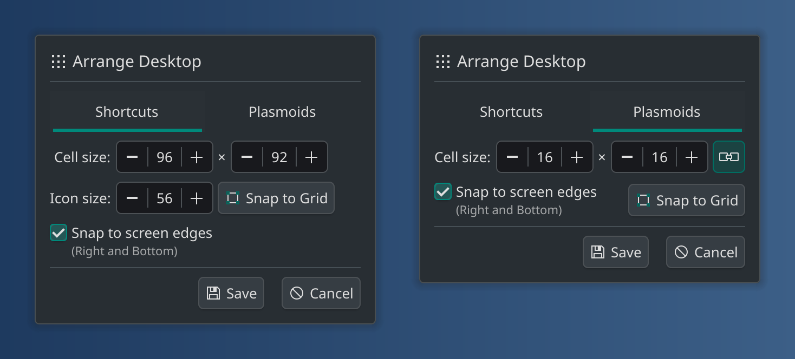

# plasma-arrange

*Made for myself with AI, offered to anyone who finds it useful.*

Arrange the widgets of the KDE Plasma desktop on grids.

In desktop edit mode, a grid is drawn and an **Arrange Desktop** panel appears:

- **Shortcuts** tab: shortcuts (*Icon* widgets) snap to a grid of cells, all with
  the same icon size, their icons aligned.\
  Each shortcut's height takes into account the number of lines of its name
  (1 or 2), so that its icon keeps exactly the chosen size.\
  The grid and shortcut sizes limit each other, so that no shortcut overflows
  its cell. They cannot be resized by hand, and do not overlap each other;
  *Snap to Grid* puts them all back on their cells.
- **Plasmoids** tab: the other widgets snap to their own grid when moved or
  resized, without overlapping each other; *Snap to Grid* aligns and resizes all
  of them at once, still without overlapping.
- **Save** keeps the changes; **Cancel** puts every widget and setting back as
  they were when entering edit mode, on all screens (widgets moved to another
  screen go back to theirs). Deleted widgets are not recreated. Both leave edit
  mode.

Default grids: shortcut cells of 96×92 px with 56 px icons, plasmoid cells of
16×16 px.



A desktop in edit mode, **Shortcuts** tab: the shortcut grid, shortcuts of the
same size with their icons aligned, the trash snapped to the bottom-right
corner of the screen.

[](https://github.com/ClarkBoggle/plasma-arrange/blob/assets/desktop-shortcuts.jpg?raw=true)

The same desktop, **Plasmoids** tab: the plasmoid grid (16×16 cells), the
widgets snapped to it.

[](https://github.com/ClarkBoggle/plasma-arrange/blob/assets/desktop-plasmoids.jpg?raw=true)

## Your system is not modified

- plasma-arrange is a **copy of Plasma's original desktop package**
  (`/usr/share/plasma/plasmoids/org.kde.desktopcontainment`), with the grid
  arrangement added to it.
- **Everything is installed in your home folder**, in
  `~/.local/share/plasma/plasmoids/org.kde.desktopcontainment`. Plasma uses a
  package found there instead of the system one, for your user only.
- **Nothing is changed in the system**: no file outside your home folder is
  written, the original package stays untouched, no root rights are needed
  (never run the scripts with `sudo`).
- To go back to the original desktop, `./uninstall.sh` removes the copy:
  Plasma uses its own package again.

## Requirements

- KDE Plasma 6.8 (made and tested with 6.8.2, on Wayland)
- `gettext` (to build the translations)
- Plasma started by systemd (`plasma-plasmashell` user service, the default)

## Installation

```sh
git clone https://github.com/ClarkBoggle/plasma-arrange.git
cd plasma-arrange
./install.sh
```

`install.sh` builds the translations, copies `package/` to
`~/.local/share/plasma/plasmoids/org.kde.desktopcontainment` and reloads the
desktop. Nothing is changed outside your home folder.

This copy takes the place of the system desktop package (`org.kde.desktopcontainment`,
the *Desktop* layout) for your user only: it is the full Plasma package with the
grid arrangement added. Folder View desktops are not affected by the grids.

Run `./install.sh` again after any change to `package/`.

## Uninstallation

```sh
./uninstall.sh
```

Removes the installed copy and reloads the desktop: Plasma uses its own package
again. Widget positions and grid settings stay in the Plasma configuration.

`install.sh` and `uninstall.sh` leave alone any other copy of the desktop
package found in `~/.local/share/plasma/plasmoids/` (they recognize theirs by
`contents/ui/GridArrange.qml`).

## After a Plasma update

Since the package is a modified copy of Plasma's, it must follow Plasma's
updates. After updating Plasma, from the cloned repository:

```sh
./install.sh
```

Seeing that the system package has changed, it runs `./update-plasma.sh` first (which can also
be run directly): it takes the new system package, applies the grid arrangement
to it again and reinstalls. If the changes conflict with the new version, it
removes the installed copy and stops: Plasma uses its own desktop until
plasma-arrange is updated for that version.

## Files

`package/` is a copy of `/usr/share/plasma/plasmoids/org.kde.desktopcontainment`
from Plasma 6.8.2 (tag `plasma-6.8.2`). Compared to it:

**Added**

| File | Role |
|---|---|
| `package/contents/ui/GridArrange.qml` | Grid logic: snapping, shortcut sizes, no overlaps, moves between screens, selection by click, locking of the other tab's widgets, saving and restoring the layout; draws the grid |
| `package/contents/ui/GridPanel.qml` | The *Arrange Desktop* panel (moved by its title, its position is kept) |
| `package/contents/ui/GridLines.qml` | Drawing of a grid |
| `package/contents/ui/GridMath.js` | Grid computations (snapping, overlaps, nearest free place) |
| `package/contents/ui/GridDrag.js` | State shared by the desktops of all screens: widget moved to another screen, where moved widgets are, Cancel |
| `po/template.pot`, `po/fr.po` | Strings to translate, French translation |
| `install.sh`, `uninstall.sh` | Installation, uninstallation |
| `build-translations.sh` | Builds the translations (called by `install.sh`) |
| `update-plasma.sh` | Update after a Plasma update (called by `install.sh`) |

**Modified**

| File | Change |
|---|---|
| `package/contents/ui/main.qml` | About 30 lines, marked *Grid arrangement*: see [Changes to main.qml](#changes-to-mainqml) |
| `package/contents/config/main.xml` | The `grid*` settings |

All the other files of `package/` are Plasma's, unchanged.

The pictures of this README, and the scenes they are rendered from, are on the
`assets` branch.

## Changes to main.qml

`main.qml` is the main file of Plasma's desktop. It is kept as close to the
original as possible: it only sets the layout cells, passes on widget moves and
creates `GridArrange` and the panel; all the logic is in `GridArrange.qml`, which
also connects to the widgets and to the panel itself (and locks the widgets of
the other tab). These lines must be carried over when a Plasma update changes
`main.qml` (`update-plasma.sh` does it).

In total: 24 lines added (5 of them comments), 4 lines of Plasma changed.
Line numbers are those of the modified `main.qml`.

**1. Layout cells** (line 309)

The layout rounds the position and size of every widget to whole cells, which
shrank the shortcut icons. With 1 px cells it rounds nothing, and `GridArrange`
does the snapping. While a widget is moved (or one from another screen is
dragged over the desktop), the cells are huge: otherwise the layout recomputes
its green placeholder at every pixel, and moving is jerky.
The minimum size (16 px) does not enlarge small shortcuts; the default size,
previously computed from the cells, is unchanged.

```diff
-            minimumItemWidth: Kirigami.Units.gridUnit * 3
+            // Grid arrangement (see GridArrange.qml): 1 px cells, huge while a widget is
+            // moved (smooth placeholder), small shortcuts not enlarged
+            minimumItemWidth: Kirigami.Units.iconSizes.small
             minimumItemHeight: minimumItemWidth
 
-            cellWidth: Kirigami.Units.iconSizes.small
+            cellWidth: gridArrange.movingWidget ? 100000 : 1
             cellHeight: cellWidth
-            defaultItemWidth: cellWidth * 6
-            defaultItemHeight: cellHeight * 6
+            defaultItemWidth: Kirigami.Units.iconSizes.small * 6
+            defaultItemHeight: Kirigami.Units.iconSizes.small * 6
```

**2. While dragging** (line 363)

The position is passed on, so that the green placeholder shows the snapped place,
and the point where the mouse holds the widget, for a move to another screen.
It must come before Plasma's code, which hides the placeholder when the widget
leaves for another screen.

```diff
                 onUserDrag: (newPosition, dragCenter) => {
+                    // Grid arrangement (before leaving for another screen below)
+                    gridArrange.widgetMoved(appletContainer, newPosition, dragCenter);
+
                     const pos = mapToItem(root.parent, dragCenter.x, dragCenter.y);
```

**3. The `GridArrange` instance** (line 392, after `placeHolder`)

Below the widgets; active only in edit mode, on a *Desktop* layout (not
Folder View). It gets the panel: it follows and changes its tab, and handles its
settings and buttons.

```diff
+            GridArrange {
+                id: gridArrange
+                anchors.fill: parent
+                z: -1
+                appletsLayout: appletsLayout
+                active: root.isContainment && !root.isFolder && Plasmoid.containment.corona.editMode
+                panel: gridPanel
+            }
```

**4. The `GridPanel` instance** (line 470, before `Component.onCompleted`)

The *Arrange Desktop* panel, at the top center, shown in edit mode.

```diff
+        // Grid arrangement settings, shown in edit mode
+        GridPanel {
+            id: gridPanel
+            z: 1000 // above the widgets
+            visible: gridArrange.active
+            // Top center by default; can then be moved by its title
+            x: Math.round((parent.width - width) / 2)
+            y: Kirigami.Units.gridUnit * 2
+        }
```

## Credits

Written with [Claude Code](https://claude.com/claude-code), reviewed by
biological eyes, approved by my dog 🐾

## License

GPL version 2 or later, the license of Plasma's desktop containment, from which
the package is derived: see [LICENSE](LICENSE). Two unchanged Plasma files
(`ActionButton.qml`, `ConfigOverlay.qml`) are under the LGPL version 2 or later,
as their headers say.
