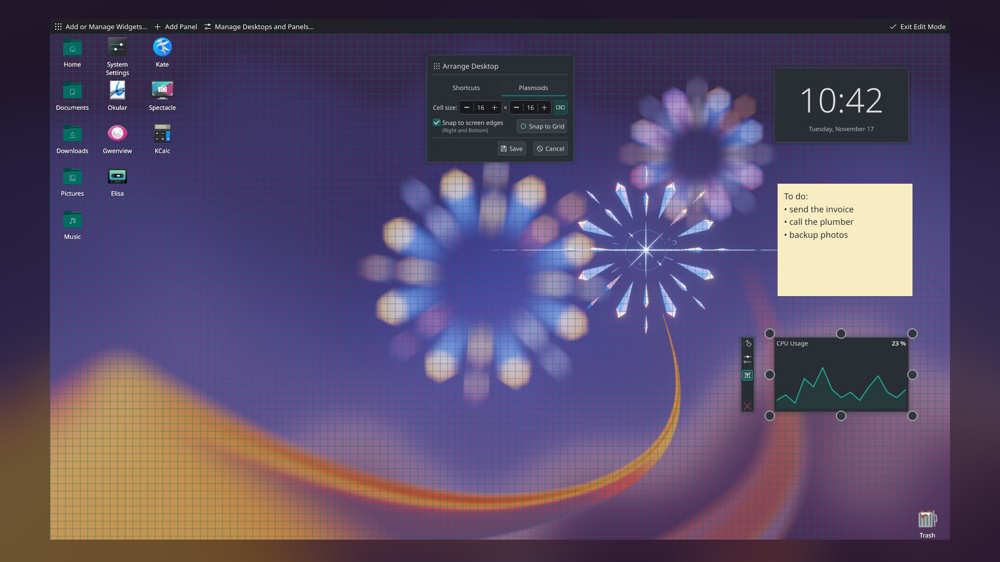

# plasma-arrange

Arrange the widgets of the KDE Plasma desktop on grids.

In desktop edit mode, a grid is drawn and an **Arrange Desktop** panel appears:

- **Shortcuts** tab: shortcuts (*Icon* widgets) snap to a grid of cells, all with
  the same icon size, their icons aligned.\
  Each shortcut's height takes into account the number of lines of its name
  (1 or 2), so that its icon keeps exactly the chosen size.\
  The grid and shortcut sizes limit each other, so that no shortcut overflows
  its cell.
- **Plasmoids** tab: the other widgets snap to their own grid, when moved or
  resized; *Snap to Grid* aligns and resizes all of them at once.
- **Save** keeps the changes; **Cancel** puts every widget and setting back as
  they were when entering edit mode, on all screens (widgets moved to another
  screen go back to theirs). Deleted widgets are not recreated. Both leave edit
  mode.

Default grids: shortcut cells of 96×92 px with 56 px icons, plasmoid cells of
16×16 px.


A desktop in edit mode, **Shortcuts** tab: the shortcut grid, shortcuts of the
same size with their icons aligned, the trash snapped to the bottom-right
corner of the screen.

[](https://github.com/ClarkBoggle/plasma-arrange/blob/assets/desktop-shortcuts.jpg?raw=true)

The same desktop, **Plasmoids** tab: the plasmoid grid (16×16 cells), the
widgets snapped to it.

[](https://github.com/ClarkBoggle/plasma-arrange/blob/assets/desktop-plasmoids.jpg?raw=true)

## Your system is not modified

- plasma-arrange is a **copy of Plasma's original desktop package**
  (`/usr/share/plasma/plasmoids/org.kde.desktopcontainment`), with the grid
  arrangement added to it.
- **Everything is installed in your home folder**, in
  `~/.local/share/plasma/plasmoids/org.kde.desktopcontainment`. Plasma uses a
  package found there instead of the system one, for your user only.
- **Nothing is changed in the system**: no file outside your home folder is
  written, the original package stays untouched, no root rights are needed
  (never run the scripts with `sudo`).
- To go back to the original desktop, `./uninstall.sh` removes the copy:
  Plasma uses its own package again.

## Requirements

- KDE Plasma 6.8 (made and tested with 6.8.2, on Wayland)
- `gettext` (to build the translations)
- Plasma started by systemd (`plasma-plasmashell` user service, the default)

## Installation

```sh
git clone https://github.com/ClarkBoggle/plasma-arrange.git
cd plasma-arrange
./install.sh
```

`install.sh` builds the translations, copies `package/` to
`~/.local/share/plasma/plasmoids/org.kde.desktopcontainment` and reloads the
desktop. Nothing is changed outside your home folder.

This copy takes the place of the system desktop package (`org.kde.desktopcontainment`,
the *Desktop* layout) for your user only: it is the full Plasma package with the
grid arrangement added. Folder View desktops are not affected by the grids.

Run `./install.sh` again after any change to `package/`.

## Uninstallation

```sh
./uninstall.sh
```

Removes the installed copy and reloads the desktop: Plasma uses its own package
again. Widget positions and grid settings stay in the Plasma configuration.

Both scripts leave alone any other copy of the desktop package found in
`~/.local/share/plasma/plasmoids/` (they recognize theirs by
`contents/ui/GridArrange.qml`).

## After a Plasma update

Since the package is a modified copy of Plasma's, it must follow Plasma's
updates. After updating Plasma, from the cloned repository:

```sh
./install.sh
```

Seeing a new Plasma version, it runs `./update-plasma.sh` first (which can also
be run directly): it takes the new system package, applies the grid arrangement
to it again (git merge from the `upstream` branch, which holds the unmodified
Plasma packages) and reinstalls. If the changes conflict with the new version,
it stops.

## Files

`package/` is a copy of `/usr/share/plasma/plasmoids/org.kde.desktopcontainment`
from Plasma 6.8.2 (tag `plasma-6.8.2`). Compared to it:

**Added**

| File | Role |
|---|---|
| `package/contents/ui/GridArrange.qml` | Grid logic: snapping, shortcut sizes, moves between screens, selection by click, saving and restoring the layout; draws the grid |
| `package/contents/ui/GridPanel.qml` | The *Arrange Desktop* panel |
| `package/contents/ui/GridLines.qml` | Drawing of a grid |
| `package/contents/ui/GridDrag.js` | State shared by the desktops of all screens: widget moved to another screen, where moved widgets are, Cancel |
| `po/template.pot`, `po/fr.po` | Strings to translate, French translation |
| `install.sh`, `uninstall.sh` | Installation, uninstallation |
| `build-translations.sh` | Builds the translations (called by `install.sh`) |
| `update-plasma.sh` | Update after a Plasma update |

**Modified**

| File | Change |
|---|---|
| `package/contents/ui/main.qml` | About 60 lines, marked *Grid arrangement*: see [Changes to main.qml](#changes-to-mainqml) |
| `package/contents/config/main.xml` | The `grid*` settings |

All the other files of `package/` are Plasma's, unchanged.

The pictures of this README, and the scenes they are rendered from, are on the
`assets` branch.

## Changes to main.qml

`main.qml` is the main file of Plasma's desktop. It is kept as close to the
original as possible: it only connects the desktop to `GridArrange` and to the
panel, all the logic is in `GridArrange.qml`. These lines must be carried over
when a Plasma update changes `main.qml` (`update-plasma.sh` lets git do it).

In total: 57 lines added (12 of them comments), 5 lines of Plasma changed.
Line numbers are those of the modified `main.qml`.

**1. Layout cells** (line 309)

The layout rounds the position and size of every widget to whole cells, which
shrank the shortcut icons. With 1 px cells it rounds nothing, and `GridArrange`
does the snapping. While a widget is moved (or one from another screen is
dragged over the desktop), the cells are huge: otherwise the layout recomputes
its green placeholder at every pixel, and moving is jerky.
The minimum size (16 px) does not enlarge small shortcuts; the default size,
previously computed from the cells, is unchanged.

```diff
-            minimumItemWidth: Kirigami.Units.gridUnit * 3
+            // Grid arrangement (see GridArrange.qml): the layout rounds the position and
+            // size of every widget to whole cells each time it places them, so its cells
+            // are 1 px and the snapping to the grids is done by GridArrange. While a widget
+            // is moved, its cells are huge instead: it would otherwise recompute its own
+            // placeholder at every pixel, over the whole widget area (slow and jerky).
+            // Its minimum item size must not enlarge small shortcuts either.
+            minimumItemWidth: Kirigami.Units.iconSizes.small
             minimumItemHeight: minimumItemWidth
 
-            cellWidth: Kirigami.Units.iconSizes.small
+            cellWidth: gridArrange.movingWidget ? 100000 : 1
             cellHeight: cellWidth
-            defaultItemWidth: cellWidth * 6
-            defaultItemHeight: cellHeight * 6
+            defaultItemWidth: Kirigami.Units.iconSizes.small * 6
+            defaultItemHeight: Kirigami.Units.iconSizes.small * 6
```

**2. Locking and hooks on each widget** (line 328)

The widgets of the other tab are locked: no handles, and a `MouseArea` on top
blocks their clicks (a click on a shortcut would launch it). `GridArrange` is
told when a drag starts or ends, and when a widget is resized.

```diff
-                editModeCondition: Plasmoid.immutable
+                // Grid arrangement: the widgets of the other tab are locked
+                editModeCondition: (Plasmoid.immutable || gridArrange.isLocked(appletContainer))
                     ? ContainmentLayoutManager.ItemContainer.Locked
                     : ContainmentLayoutManager.ItemContainer.AfterPressAndHold
 
+                // Grid arrangement: snapping when moved or resized
+                onDragActiveChanged: gridArrange.widgetDragActiveChanged(appletContainer)
+                onWidthChanged: gridArrange.widgetResized(appletContainer)
+                onHeightChanged: gridArrange.widgetResized(appletContainer)
+
+                // Grid arrangement: a locked widget does not react to clicks either
+                // (a click on a shortcut would launch it)
+                MouseArea {
+                    anchors.fill: parent
+                    z: 1000
+                    enabled: gridArrange.isLocked(appletContainer)
+                    acceptedButtons: Qt.AllButtons
+                }
```

**3. While dragging** (line 383)

The position is passed on, so that the green placeholder shows the snapped place,
and the point where the mouse holds the widget, for a move to another screen.

```diff
                 onUserDrag: (newPosition, dragCenter) => {
+                    gridArrange.widgetMoved(appletContainer, newPosition, dragCenter);
+
                     const pos = mapToItem(root.parent, dragCenter.x, dragCenter.y);
```

**4. The `GridArrange` instance** (line 410, after `placeHolder`)

Below the widgets; active only in edit mode, on a *Desktop* layout (not
Folder View). It gets the panel, to know and change its tab.

```diff
+            GridArrange {
+                id: gridArrange
+                anchors.fill: parent
+                z: -1
+                appletsLayout: appletsLayout
+                active: root.isContainment && !root.isFolder && Plasmoid.containment.corona.editMode
+                panel: gridPanel
+            }
```

**5. The `GridPanel` instance** (line 487, before `Component.onCompleted`)

The *Arrange Desktop* panel, at the top center. It passes its settings and
buttons on to `GridArrange`: *Save* leaves edit mode, *Cancel* puts the layout
back as it was (`restoreSavedLayout()`, then the desktops of the other screens
when edit mode ends), then leaves.

```diff
+        // Grid arrangement settings, shown in edit mode
+        GridPanel {
+            id: gridPanel
+            z: 1000 // above the widgets
+            visible: gridArrange.active
+            // Top center by default; can then be moved by its title
+            x: Math.round((parent.width - width) / 2)
+            y: Kirigami.Units.gridUnit * 2
+            tallestShortcutHeight: gridArrange.tallestShortcutHeight
+            largestIconSize: gridArrange.largestIconSize
+            onShortcutGridChangeRequested: (cellWidth, cellHeight, iconSize) =>
+                gridArrange.setShortcutGrid(cellWidth, cellHeight, iconSize)
+            onSnapPlasmoidsRequested: gridArrange.snapAllPlasmoids()
+            onSaveRequested: Plasmoid.containment.corona.editMode = false
+            onCancelRequested: {
+                gridArrange.restoreSavedLayout();
+                Plasmoid.containment.corona.editMode = false;
+            }
+        }
```

## Credits

Written with [Claude Code](https://claude.com/claude-code).

## License

The package is derived from Plasma's desktop containment, licensed under the
GPL (version 2 or later).
